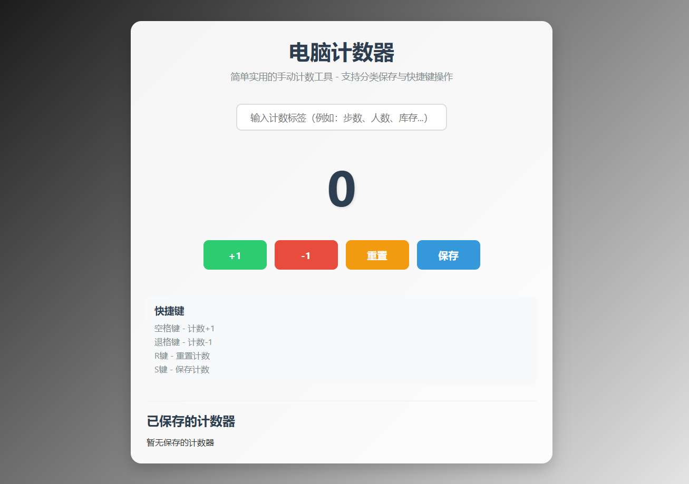

# 手动计数器

## 简介

这是一个简单实用的手动计数工具，一个页面可以同时管理多个计数器，适用于统计人数、记录步数、库存管理等场景。所有数据自动保存在浏览器本地。

## 功能特点

- 同一页面创建任意数量的计数器
- 每个计数器独立增减（+1 / -1）、重置、删除
- 计数器名称可直接编辑
- 数据自动保存到 localStorage，刷新不丢失
- 点击卡片即可切换当前计数器
- 快捷键操作，提高效率
- 响应式设计，适配不同设备

## 使用方法

1. 点击右上角「+ 新增计数器」新建计数器
2. 点击卡片选中它，然后在名称输入框中修改名称
3. 使用卡片上的按钮进行计数：
   - 「+1」增加计数
   - 「-1」减少计数（最小为 0）
   - 「重置」将计数归零
   - 「✕」删除该计数器
4. 所有修改都会自动保存，无需手动操作

## 快捷键

快捷键作用于当前选中的计数器（蓝色边框高亮）：

- 空格键：计数 +1
- 退格键：计数 -1
- R 键：重置当前计数器
- N 键：新增计数器

## 技术说明

- 纯 HTML/CSS/JavaScript 实现，无需后端
- 使用 localStorage 保存数据（键名 `manualCounters`）
- 响应式设计，适配手机和电脑

## 安装

无需安装，直接打开 HTML 文件即可使用。
